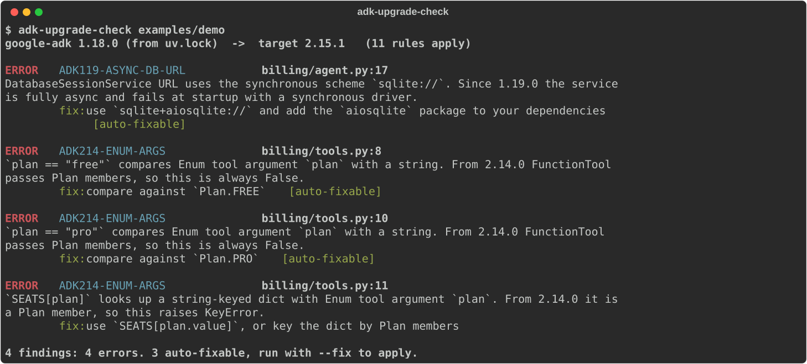
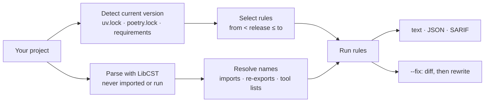

<div align="center">

# adk-upgrade-check

**Find the code a [Google ADK](https://github.com/google/adk-python) upgrade will break, before you upgrade.**

[](https://pypi.org/project/adk-upgrade-check/)
[](https://github.com/Reuben-Alex/adk-upgrade-check/actions/workflows/ci.yml)
[](https://pypi.org/project/adk-upgrade-check/)
[](#rules)
[](https://github.com/Reuben-Alex/adk-upgrade-check/blob/main/LICENSE)



</div>

`google-adk` ships breaking changes in minor releases, and some of them aren't labelled as breaking.
`adk-upgrade-check` reads your project, works out which ADK version you're on, and points to the
exact lines that the target release breaks. Each finding names the release that caused it, links the
upstream change and says how to fix it. With `--fix`, it rewrites the mechanical cases.

- **Static and offline.** It parses your code with [LibCST](https://github.com/Instagram/LibCST)
  and never imports or runs it. No API keys, no LLM calls, and no need to install the target ADK.
- **Version-aware.** It reads your current version from `uv.lock`, `poetry.lock`, `pdm.lock`,
  `requirements*.txt` or `pyproject.toml`, and runs only the rules for releases you are crossing.
- **Checked against real releases.** Every error-level rule is reproduced on the `google-adk`
  versions either side of the change it detects ([ground truth](#accuracy)).
- **Low noise.** Each finding is `certain` or `likely`, and only `certain` findings fail CI by
  default.
- **Built for CI.** Exit codes, JSON, SARIF for GitHub code scanning, a GitHub Action and a
  pre-commit hook.

## Quick start

```bash
# Run it once, without installing (needs uv: https://docs.astral.sh/uv/)
uvx adk-upgrade-check .

# Or install it
pipx install adk-upgrade-check        # or: pip install adk-upgrade-check
adk-upgrade-check path/to/your/agent --to 2.15.1
```

Apply the safe rewrites. The tool shows the diff first, and refuses to run on uncommitted changes:

```diff
$ adk-upgrade-check . --fix
--- a/billing/tools.py
+++ b/billing/tools.py
@@ -5,7 +5,7 @@
 def get_price(plan: Plan, seats: int = 1) -> dict:
   """Returns the monthly price for a plan."""
-  if plan == "free":
+  if plan == Plan.FREE:
     return {"plan": plan.value, "price": 0}
-  per_seat = 20 if plan == "pro" else 15
+  per_seat = 20 if plan == Plan.PRO else 15
```

## Rules

A rule runs when your current version is older than the release that introduced the change and the
target version is at least that release: `--from < release <= --to`. Run
`adk-upgrade-check explain <RULE_ID>` for the details of any rule.

| Rule | Release | What breaks | Auto-fix |
|---|---|---|---|
| [`ADK119-ASYNC-DB-URL`](src/adk_upgrade_check/rules/adk119_async_db_url.py) | 1.19.0 | A synchronous DB URL (`sqlite:///`, `postgresql://`, `+psycopg2`, `mysql+pymysql`…) given to `DatabaseSessionService` fails at startup. The rule checks code, the `.env` files and deploy manifests that set the URL, and `--session_service_uri` flags. The changelog listed this as a feature, not a breaking change. | ✅ |
| [`ADK119-SQLITE-SERVICE`](src/adk_upgrade_check/rules/adk119_sqlite_service.py) | 1.19.0 | `adk web` / `adk api_server --session_service_uri sqlite:///…` switches to `SqliteSessionService`, which refuses a database written by 1.18 or earlier until it is migrated. Not in the changelog's breaking changes. | |
| [`ADK200-DIRECT-APPEND`](src/adk_upgrade_check/rules/adk200_direct_append.py) | 2.0.0 | `ctx.session.events.append(event)` bypasses the 2.0 event pipeline, so the event is never persisted, routed or streamed. | |
| [`ADK200-EVENT-SCHEMA`](src/adk_upgrade_check/rules/adk200_event_schema.py) | 2.0.0 | A custom `BaseSessionService` that maps events to fixed columns breaks on the new `node_info` and `output` fields. | |
| [`ADK206-ARTIFACT-NS`](src/adk_upgrade_check/rules/adk206_artifact_ns.py) | 2.6.0 | `FileArtifactService` moves artifacts to a per-app path. The next save of an existing artifact restarts its version numbering. | |
| [`ADK207-PYARROW-EXTRA`](src/adk_upgrade_check/rules/adk207_pyarrow_extra.py) | 2.7.0 | `BigQueryAgentAnalyticsPlugin` with `google-adk[gcp]` fails to import, because pyarrow moved to the `bigquery-analytics` extra. | ✅ |
| [`ADK213-OTEL-SEMCONV`](src/adk_upgrade_check/rules/adk213_otel_semconv.py) | 2.13.0 | Dashboards, exporters and queries that read the `call_llm` span go empty under the new default OTel GenAI v2 schema. | |
| [`ADK214-ENUM-ARGS`](src/adk_upgrade_check/rules/adk214_enum_args.py) | 2.14.0 | Enum tool arguments arrive as members, not strings, so `plan == "pro"`, `d[plan]`, `match`, `json.dumps` and `str` methods all change behaviour. Follows tools across modules, re-exports and `tools=ALL_TOOLS` lists. | ✅ |
| [`ADK214-VERTEX-SESSION-KWARGS`](src/adk_upgrade_check/rules/adk214_vertex_session_kwargs.py) | 2.14.0 | `VertexAiSessionService.create_session(session_state=..., sessionId=..., ...)` raises `ValueError`. | ✅ |
| [`ADK215-BUILDER-REMOVED`](src/adk_upgrade_check/rules/adk215_builder_removed.py) | 2.15.0 | `google.adk.cli.built_in_agents` and the `/dev/apps/{app}/builder*` routes are gone. | |
| [`ADK215-MCP-PROMPT-ARGS`](src/adk_upgrade_check/rules/adk215_mcp_prompt_args.py) | 2.15.0 | `McpInstructionProvider` no longer fills prompt arguments from `session.state`. | |

## Use it in CI

The most useful moment to run it is on the pull request that bumps `google-adk`: Dependabot,
Renovate or your own.

**GitHub Action**, with findings in the Security tab through code scanning:

```yaml
# .github/workflows/adk-upgrade-check.yml
on:
  pull_request:
    paths: ["pyproject.toml", "uv.lock", "requirements*.txt", "**/*.py"]

jobs:
  adk-upgrade-check:
    runs-on: ubuntu-latest
    permissions:
      contents: read
      security-events: write
    steps:
      - uses: actions/checkout@v4
      - uses: Reuben-Alex/adk-upgrade-check@v0.2.0
        with:
          to: latest
          sarif: adk-upgrade-check.sarif
      - uses: github/codeql-action/upload-sarif@v3
        if: always()
        with:
          sarif_file: adk-upgrade-check.sarif
```

**pre-commit:**

```yaml
repos:
  - repo: https://github.com/Reuben-Alex/adk-upgrade-check
    rev: v0.2.0
    hooks:
      - id: adk-upgrade-check
        args: ["--to", "latest"]
```

<details>
<summary><b>All options</b></summary>

| Option | Meaning |
|---|---|
| `PATH` | Project root. Default: `.` |
| `--from VERSION` | Your current `google-adk`. Default: detected from lock files and requirements. |
| `--to VERSION` | The version you're upgrading to, or `latest`. Default: `2.15.1`, the newest release the rules cover. |
| `--format text\|json\|sarif` | Output format. |
| `--fail-on error\|warning\|info\|never` | Lowest severity that exits 1. Default: `error`. |
| `--strict` | Let `likely` findings fail the run too. |
| `--fix` | Apply auto-fixes, printing the diff first. Refuses on uncommitted changes. |
| `--force` | With `--fix`: run without a clean git tree. |
| `--rule ID` | Run only this rule (repeatable). |
| `--exclude GLOB` | Skip matching paths (repeatable). |
| `--color auto\|always\|never` | Colour the text output. Honours `NO_COLOR`. |

Exit codes: `0` nothing at or above `--fail-on`, `1` findings, `2` usage error.

Subcommands: `adk-upgrade-check list-rules` and `adk-upgrade-check explain <RULE_ID>`.

</details>

## How it works



- **Name resolution, not text search.** `from google.adk.tools import FunctionTool as FT` and
  `import google.adk.sessions as s` both resolve to the real ADK symbol, so look-alike names from
  other libraries don't match.
- **Cross-file analysis.** For the Enum rule, the tool finds which functions are tools by following
  `Agent(tools=[...])` and `FunctionTool(fn)` through imports, package re-exports, shared
  `ALL_TOOLS` lists, methods (`self.lookup`, `billing.lookup`), Agent Config YAML
  (`tools: - name: my_agent.tools.get_price`) and monorepo layouts. It then checks how those
  functions use their Enum parameters.
- **Beyond Python.** Database URLs are followed from the code that reads them (`os.environ["X"]`)
  into `.env` files, Dockerfiles, docker-compose, Kubernetes manifests and shell scripts. The checker
  also reads `--session_service_uri` flags in deploy scripts, including `$VAR` references.
- **Fast.** Only files that mention `google.adk` are parsed up front. Everything else is parsed on
  demand, when an import resolves to it. google/adk-samples (1,956 files) takes about 14 seconds.
- **Formatting-preserving fixes.** Fixes are applied as text edits at exact source positions, so
  comments, quotes and line endings are left as they were.

## Accuracy

**Ground truth.** [`tests/ground_truth/`](tests/ground_truth) reproduces each break on real
releases:

| Rule | Before | After |
|---|---|---|
| ADK119-ASYNC-DB-URL | 1.18.0: `sqlite:///` works | 1.19.0: `ValueError`, while `sqlite+aiosqlite:///` works |
| ADK119-SQLITE-SERVICE | 1.18.0: CLI `sqlite:///` writes sessions with `DatabaseSessionService` | 1.19.0 and 2.15.1: `RuntimeError: … seems to use an old schema. Please run the migration command` |
| ADK207-PYARROW-EXTRA | 2.6.3 `[gcp]`: plugin and pyarrow import | 2.7.0 `[gcp]`: `ImportError: pyarrow is required` |
| ADK214-ENUM-ARGS | 2.13.0: the tool (a function or a bound method) gets `str`, and `plan == "pro"` is `True` | 2.14.0: it gets `Plan`, and `plan == "pro"` is `False` |
| ADK214-VERTEX-SESSION-KWARGS | 2.13.0: `session_state=` is accepted | 2.14.0: `ValueError: Unsupported create_session option(s)` |
| ADK215-BUILDER-REMOVED | 2.14.1: `google.adk.cli.built_in_agents` imports | 2.15.0: `ModuleNotFoundError` |

All six error-level rules are reproduced this way. The warning and info rules come from the tagged
source and changelog, and they don't fail CI by default. A rule is dropped when the break it
describes doesn't reproduce. The 2.0 notes say overridden `_run_async_impl`
methods are bypassed, but on the `Runner` path they still run in 1.39.1, 2.0.0 and 2.15.1
([`run_override.py`](tests/ground_truth/run_override.py)). So there is no rule for that, because it
would flag working code.

**Real projects.** All rules were forced on (`--from 1.0.0`) across
[google/adk-samples](https://github.com/google/adk-samples) and 22 public ADK projects found through
GitHub code search, and every finding was labelled by hand:

| Rule | Findings | Real breaks | Notes |
|---|---:|---:|---|
| ADK119-ASYNC-DB-URL | 9 | 9 | 7 repos; two are pinned to exactly 1.18.0. |
| ADK119-SQLITE-SERVICE | 2 | 2 | `likely`. Both scripts break on upgrade, but through the repo's own CLI wrapper, which raises the async-driver error rather than the schema error. |
| ADK213-OTEL-SEMCONV | 3 | 2 | `likely`. The other one already handles both schemas. |
| ADK215-MCP-PROMPT-ARGS | 1 | 0 | `likely`. The prompts take no arguments. |
| The other seven rules | 0 | – | No noise. Of 461 tool functions found (7 of them methods), one had an Enum parameter, and it was used safely. |

Every `certain` finding was a real break. The two wrong findings are both `likely`, so neither would
fail a CI run by default.

## Limitations

- Tool lists built at runtime (`self.tools.append(...)`, list comprehensions, plugin registries) and
  methods inherited from a base class aren't followed.
- In Kubernetes manifests, a `--session_service_uri` flag is read from the line it appears on, so a
  `command:`/`args:` split over several YAML lines is only partly understood.
- Env vars are matched by name across the whole project. A variable set differently per environment
  is checked in every file that sets it.
- The checker reports what your code will hit. It doesn't migrate session data: for that, use
  `adk migrate session`.

## Roadmap

- More rules for the 2.x behaviour changes, and generated rules for every `DeprecationWarning` site.
- A semi-automated rule pipeline: watch PyPI for new releases, diff the tagged sources and
  changelog, draft a rule with fixtures, gate it on ground truth and the corpus, then review it by
  hand.
- A read-only database preflight that compares your live session schema with what the target
  release expects.

## Contributing

Rules are small and self-contained, and each one comes with fixtures and a ground-truth check. See
[CONTRIBUTING.md](CONTRIBUTING.md) for how to add one.

## License

[Apache-2.0](LICENSE). This is an independent project, not affiliated with or endorsed by Google.
